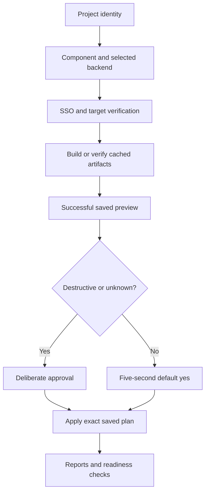
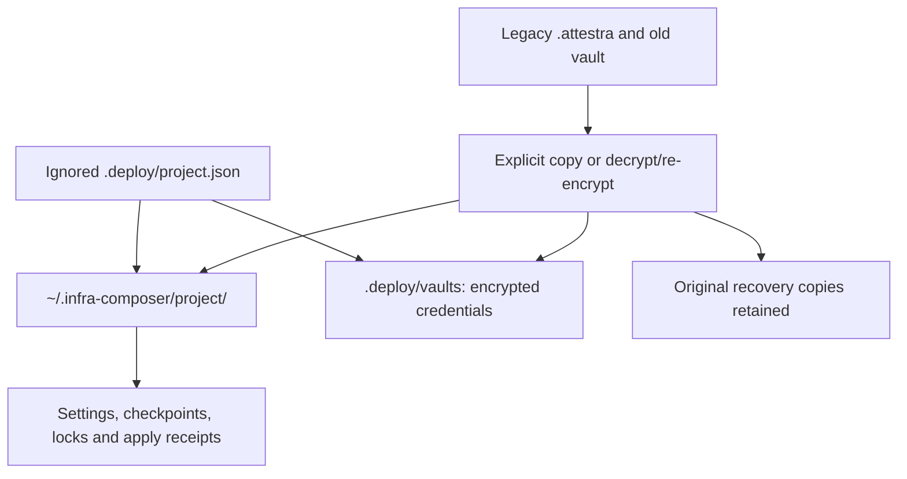

# Attestra deployment operations

Attestra owns application orchestration, shared admin/index infrastructure and environment backends. Feature libraries retain their runtime and resource ownership. Read [the alignment matrix](deployment-alignment.md) before rollout: this operator is not yet fully aligned with the requested deployment contract.



## Local commands

Use Go 1.27.3+, AWS CLI v2 with an existing IAM Identity Center profile, and Pulumi CLI supporting saved plans. The current presence checks do not enforce every minimum version. Run launchers from any directory. Windows uses `deploy.bat` with the same flags.

```sh
# First run: project identity comes first, followed by environment setup.
./deploy.sh

# Prepare/reconcile setup without authorizing application/shared apply.
./deploy.sh -bootstrap

# Explicit continuation when setup needs to deploy shared prerequisites.
./deploy.sh -bootstrap -deploy

# Existing configured backend (explicit selection is visible before mutation).
./deploy.sh -stack dev -sso -profile attestra

# Existing shared infrastructure only; no backend deployment.
./deploy.sh -scope shared -sso -profile attestra

# Shared once, then only the selected dev backend; stops on shared failure.
./deploy.sh -scope both -stack dev -sso -profile attestra

# Build only. No deployment identity, credentials or apply.
./deploy.sh -build

# Explicit read-only preview/report paths. See credentials note below.
./deploy.sh -preview -stack dev -backend s3://STATE-BUCKET/PREFIX -region us-east-2
./deploy.sh -report -stack dev
./deploy.sh -report -refresh -stack dev
./deploy.sh -health-check -stack dev
```

`-preview` and report refresh use the configured credential chain and `PULUMI_CONFIG_PASSPHRASE`; they do not unlock the local vault. Use an existing SSO session and protected environment mechanisms for the passphrase. This reporting preview is still a separate entry path: it does not yet offer all the build/setup behavior of interactive deployment. Setup can create an authorized state bucket or initialize a genuinely new stack, but cannot apply shared/backend resources without explicit deploy intent. If prerequisite apply is needed, setup reports incomplete progress rather than marking completion.

Routine text questions with a valid default and ordinary deployment approvals use five seconds automatically; `-timed-confirm` remains a compatibility spelling, not a prerequisite. Enter accepts immediately. Routine approval accepts y/n immediately. Escape, Ctrl+C, EOF/closed input and input errors cancel. Incomplete typed overrides at the deadline cancel instead of approving. The terminal reader is cancelled/joined and pending input flushed before another question. Some legacy menus remain manual; the matrix lists the gap.

The final approval follows a successful preview. Plans are private process-local files under `.deploy/plans/`, checked for tampering, target/credential changes and changed source/config/artifacts; they expire after 20 minutes. Applies consume `--plan` with `--skip-preview`. A plan cannot approve another apply. Pulumi enforces its remote plan/state constraints. A failed preview never creates an apply capability. Deletion/replacement or a missing/invalid summary always requires deliberate manual confirmation; CI refuses those plans. No countdown authorizes teardown, nuke, state recovery, credential replacement or signing approval.

## Records and migration



Central operator records are authoritative; `.deploy/` contains the checkout identity, component/environment selection, bootstrap/settings snapshots, vaults, cache manifests and private plans. Reports retain their existing private `deployment-reports/` and `.cache/infra-composer/` locations. Schema versions protect new identity/settings/cache records; not every historical receipt has a common envelope yet. Different account/region deployments should use separate project identities. A name collision, changed repository or moved checkout stops for deliberate recovery.

Before upgrading an existing checkout, stop other operators and back up its `.attestra/`, Pulumi YAML/backups, vault files and passphrases. Migration is local only:

```sh
./deploy.sh -project attestra -migrate-records
./deploy.sh -project attestra -stack dev -migrate-vault
```

Record migration copies recognized histories/recovery siblings, rejects conflicting destinations and locks, and retains originals. Interrupted identical copies can resume. Do not rerun migration after subsequent deployment/teardown activity without comparing histories. The migration completion marker prevents automatic recopy on normal runs.

Vault migration authenticates the legacy repository/environment scope with its existing unlock passphrase, decrypts in memory, encrypts to the project/repository/environment scope under `.deploy/vaults/`, verifies every credential and retains the original encrypted file. It never renames a file to evade scope checks. An incorrect passphrase, corrupt file or existing destination stops without overwriting either vault. Keep vault and Pulumi passphrases in a password manager; they are distinct from SSO and S3 authentication. Linux files/directories use private modes; native Windows ACL verification is outstanding.

Flags override compatible settings, followed by defaults. Changed saved account/region/backend constraints stop for deliberate reconfiguration. Vault unlock may be necessary once each run; valid SSO sessions are reused. Stored GitHub secret values cannot be verified remotely and are preserved by routine setup; use explicit fresh credentials for deliberate replacement.

## GitHub Actions

The manual Action exposes **Admin/index**, **Backend**, and **All**. All runs one shared job and then exactly the selected backend. It never enumerates all environments or selects production implicitly. The shared job uses the selected protected admin GitHub environment, an independently scoped role and the shared S3 lease. Backend jobs use their protected environment and per-environment concurrency. No active update is cancelled.

The independent admin GitHub environment/OIDC setup is **not yet automated**. An authorized operator must review/configure its exact role policies, repository/environment trust, branch protections, `AWS_ACCOUNT_ID`, `AWS_REGION`, `AWS_ROLE_ARN`, `PULUMI_BACKEND_URL`, `PULUMI_STACK=shared`, and `PULUMI_CONFIG_PASSPHRASE`. Do not reuse or broaden a backend role merely to make the shared job pass. No live GitHub or IAM settings were changed as part of this implementation.

CI invokes the same Go program with explicit project/account/region/backend/stack and `-ci preview` or `-ci deploy -approve`. Temporary OIDC credentials and the passphrase arrive through protected environment inputs. CI never invokes workstation SSO or creates state storage. Shared CI does not run the operator's admin-authentication reconciliation helper; that maintenance remains local. All passes an allowlisted shared table/API binding receipt between jobs; the backend checks its account/region and configured references before preview/apply. Recorded outputs still do not establish live readiness.

## Cache, recovery and reports

Build cache discovery fingerprints transitive Go package inputs, embedded files, module metadata, effective Go environment/toolchain, build flags and the packaging recipe. ZIP bytes have separate SHA256 digests. Missing/tampered output rebuilds its target. Set `ATTESTRA_BUILD_WORKERS=1` through `16` to bound compilation; the default is capped at four. Shared and backend builds use the same cache/lock. Failed targets do not publish a manifest; completed independent cache entries survive. A cache hit never skips the Pulumi preview.

New state buckets receive versioning, AES256 encryption, public blocking and a deny-insecure-transport policy. Existing storage must pass owner/region/versioning/encryption/public/TLS checks; an inaccessible bucket is not absence. Existing policy statements are never replaced automatically to add TLS. An initialized missing stack or bucket stops for state recovery. Before-stack-initialization bootstrap receipt coverage remains incomplete; review this path carefully.

Encrypted configuration is restored before new backend selections; existing local YAML is retained under private `.deploy/config-backups/` before refresh. After interruption, retain records, YAML, vaults and state versions. Rerun the original command with the same project/target after addressing its reported failure. Start a fresh preview; do not replay a plan as an approval. If a lock remains, inspect its process/lease and recovery receipt first. Never remove a lock belonging to an active operator. Backend index publication recovery retains its existing `-publish-index`/CI `publish` flow; the workflow uploads only its specific safe pending receipt and safe report bundles.

Composer JSON/Markdown/HTML reports preserve the creating feature's owner, partial failures and independent timestamps. “Recorded” means state evidence; exact live checks establish presence/absence, and unavailable checks mean unknown. Apply receipts are written after successful `up`; they record reviewed input/plan fingerprints, not a normalized live-resource fingerprint or proof that all readiness checks succeeded.

Teardown, all-environment nuke, credential management, Android export and association commands retain their existing explicit approval boundaries. Read [the operator guide](../tools/deploy/README.md) before those operations. Migration changes receipt paths, never deletion scope. Shared SES identities, existing physical names, domains, state backend URLs and feature contracts are unchanged.

Local tests use fake clocks, fake executables, mocked APIs and temporary state. They do not prove live IAM/OIDC/DNS/SES behavior. Cross-compiling Windows binaries does not test Windows consoles, ACLs, cmd.exe argument parsing or cancellation. Review the matrix before treating this branch as a complete deployment-standard migration.
